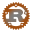
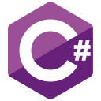
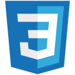
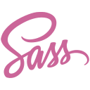

### Some things I use, like or want to learn

<table>
  <tr>
    <td>
      languages
    </td>
    <td>

    </td>
  </tr>
  <tr>
    <td>
      frameworks
    </td>
    <td>

[<picture align="left"><source media="(prefers-color-scheme: light)" srcset="./assets/fa-brands_symfony_lightmode.svg" /></picture>](https://symfony.com "Symfony")

    </td>
  </tr>
  <tr>
    <td>
      html/styling
    </td>
    <td>

    </td>
  </tr>
  <tr>
    <td>
      testing
    </td>
    <td>

    </td>
  </tr>
  <tr>
    <td>
      gamedev
    </td>
    <td>

[<picture align="left"><source media="(prefers-color-scheme: light)" srcset="./assets/bootstrap-icons_unity_lightmode.svg" /></picture>](https://unity.com "Unity")

    </td>
  </tr>
</table>
